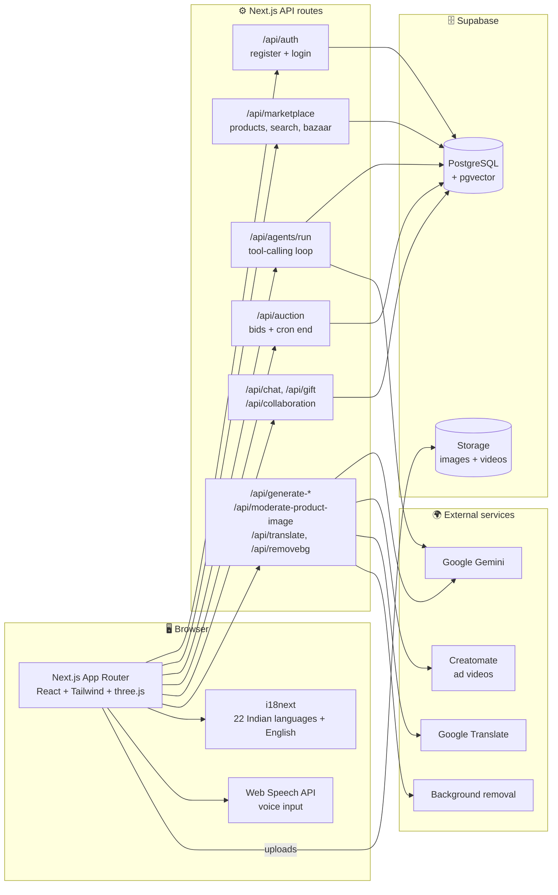
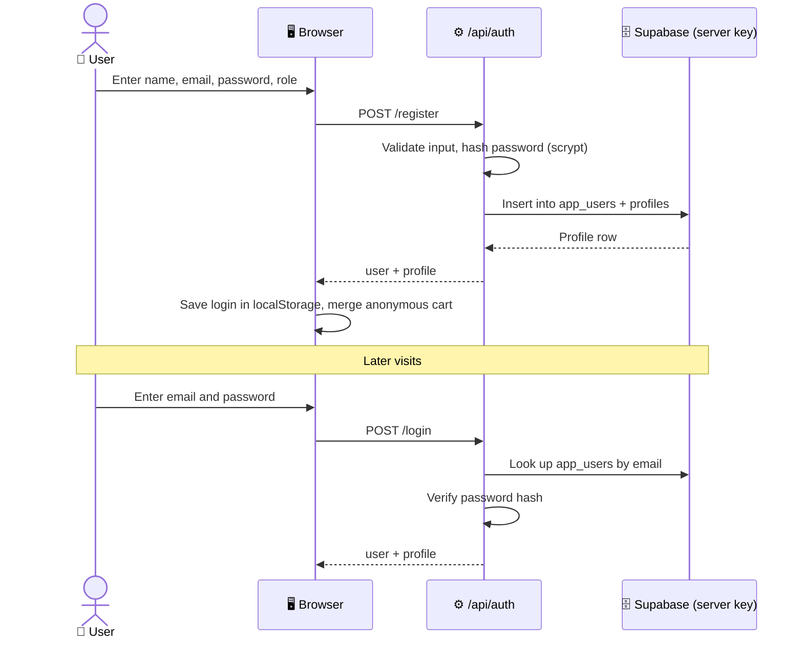
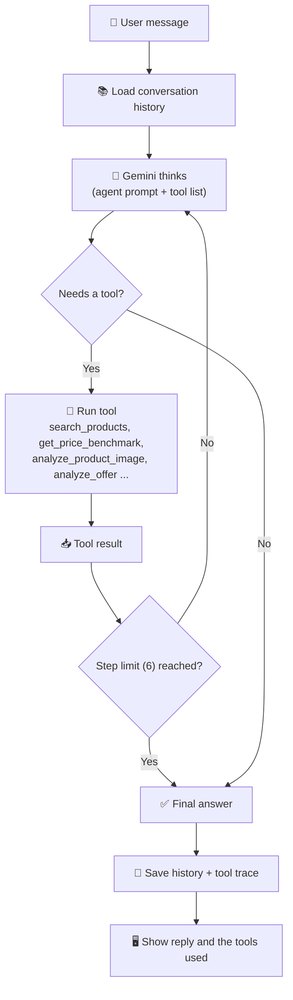
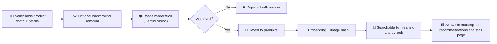
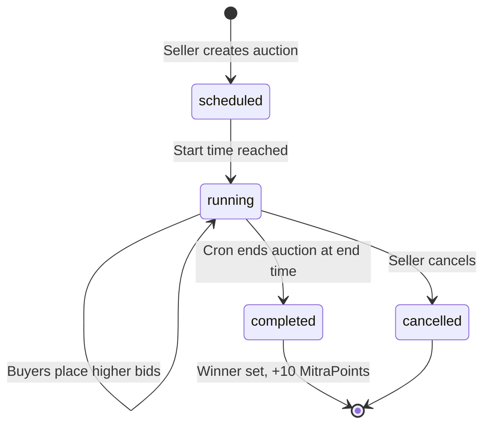

<div align="center">


# 🪔 Karigari

### Your Artisan Marketplace — Preserving Tradition, Empowering Artisans

A multilingual, voice-friendly marketplace where Indian artisans sell handmade crafts, run live auctions,
share reels, collaborate with each other and get help from AI agents.


[✨ Features](#-features) •
[🧭 How it works](#-how-it-works) •
[🛠️ Tech stack](#️-tech-stack) •
[🚀 Getting started](#-getting-started) •
[🗄️ Database](#️-database) •
[☁️ Deployment](#️-deployment) •
[📄 Credits & licence](#-credits--licence)

</div>

---

## 🌟 Overview

Karigari connects **artisans** (sellers) with **buyers**. Sellers get a personal stall, AI help for listings and
stories, auctions, reels and collaboration tools. Buyers get search, recommendations, gifting, chat, AR previews and
an AI shopping assistant, in their own language and, where the browser supports it, by voice.

| 🧑‍🎨 For artisans | 🛍️ For buyers | 🤖 Powered by AI |
|---|---|---|
| Your own stall page and 3D stall | Semantic search and recommendations | Five tool-using AI agents |
| AI product stories, ads and tutorials | Voice input and an AI shopping assistant | Image moderation and embeddings |
| Auctions, reels, collaborations | Gifts, group gifts, custom craft requests | Translation into 22 Indian languages |

---

## ✨ Features

### 🛍️ Buyers
- 🔎 **Marketplace and search**: browse by category, plus **semantic search** that understands meaning, not only keywords
- 🎙️ **Voice input** in the AI chat, direct messages and the 3D navigator (browser speech recognition)
- 🤖 **AI shopping assistant** and a **recommendations** page driven by your activity
- 🛒 **Cart** that works before you sign in and merges into your account afterwards, plus a **wishlist**
- 📖 **Product pages** with the artisan's story and **AR preview** (WebXR, on supported devices)
- 🎁 **Gifting**: send a gift, or start a **group gift** where friends chip in
- 🧵 **Custom craft requests** sent straight to a seller
- 💬 **Direct and group chat**, **follow** your favourite artisans
- 🔨 **Live auctions** with bidding and **MitraPoints** on the 🏆 leaderboard (10 points per auction won)
- 🎬 **Reels** with likes and comments, and public **stall pages**
- 🧭 **3D bazaar** you can walk around (three.js)

### 🧑‍🎨 Artisans (sellers)
- 🏪 **Seller dashboard** with product management and **analytics** (stall views and activity)
- ✍️ **AI product form**: story generation, background removal and **image moderation** (Gemini Vision) before a product goes live
- 🎞️ **AI ad videos** (Creatomate) and 📄 **PDF tutorials** for **virtual products** such as kolam designs
- 🔨 Create and end **auctions**, upload **reels**
- 🤝 **Collaborations**: partner with another seller, add shared products and agree a **revenue split** through proposals
- 🎨 **Stall customization**: themes, welcome message, featured products
- 🏛️ **Scheme Connect**: a list of government and private schemes for vendors
- 💳 **UPI ID** saved on the profile (sellers are prompted for it)

### 🌐 Platform
- 🗣️ **22 Indian languages + English**: Hindi, Assamese, Bengali, Bodo, Dogri, Gujarati, Kannada, Kashmiri, Konkani,
  Maithili, Malayalam, Manipuri, Marathi, Nepali, Odia, Punjabi, Sanskrit, Santhali, Sindhi, Tamil, Telugu, Urdu
- 🌗 **Light and dark theme**
- 🧑‍🏫 **Guided tours** (Intro.js)
- 🔔 **Notifications** for bids, sales and activity
- 🛡️ Optional **rate limiting** (Upstash) and scheduled **cron jobs** for auctions, product checks and clean-up
- 🔐 **Built-in email and password login** (no email confirmation, no third-party auth service)

### 🧠 AI agents (`/agents`)

| Agent | What it helps with |
|---|---|
| 🛍️ **Buyer** | Finding and comparing products |
| 🧑‍🎨 **Artisan** | Listings, pricing guidance, product images |
| 🧭 **Discovery** | Exploring stalls and categories |
| 🤝 **Negotiation** | Analysing offers and drafting replies |
| 📊 **Business Intelligence** | Insights on a seller's performance |

Agents run on Google Gemini, can call **11 tools** over **up to 6 reasoning steps** per request, and keep
**conversation history** per user and session. Their tools mostly **read and draft**; they do not yet act for the user.

---

## 🧭 How it works

### 🏗️ Architecture



### 🔐 Sign-up and sign-in



### 🤖 AI agent loop



### 🖼️ From upload to listing



### 🔨 Auction lifecycle



---

## 🛠️ Tech stack

| Layer | Technology |
|---|---|
| 🖥️ Frontend | Next.js (App Router), React, TypeScript, Tailwind CSS, Framer Motion, Swiper, Lucide icons |
| 🧊 3D and AR | three.js, WebXR |
| 🌐 i18n | i18next, react-i18next, browser language detection |
| ⚙️ Backend | Next.js API routes (Node runtime) |
| 🗄️ Database | Supabase PostgreSQL with **pgvector**, Supabase Storage |
| 🔐 Auth | Built-in email and password (scrypt hashes in `app_users`) |
| 🤖 AI | Google Gemini (`@google/genai`, `@google/generative-ai`), Transformers.js embeddings (`all-MiniLM-L6-v2`, 384 dimensions) |
| 🎞️ Media | Creatomate (ad videos), PDFKit and pdf-lib (tutorial PDFs), background removal API |
| 🛡️ Ops | Upstash Redis rate limiting (optional), Vercel cron |
| 🔍 Search helpers | Fuse.js, pgvector cosine similarity |

---

## 🚀 Getting started

### ✅ Prerequisites
- Node.js 20 or newer and npm
- A free [Supabase](https://supabase.com) project
- A free [Google AI Studio](https://aistudio.google.com) key for the AI features

### 1️⃣ Install
```bash
git clone https://github.com/kavya19official/Karigari.git
cd Karigari
npm install
```

### 2️⃣ Create the database
In Supabase open **SQL Editor → New query**, paste the whole of [`supabase/schema.sql`](supabase/schema.sql) and click
**Run**. It is safe to run again. It creates the tables, the database functions, the `images` and `videos` storage
buckets and the login table.

### 3️⃣ Add your keys
```bash
cp .env.example .env.local
```
Fill in `.env.local` (see the table below), then start the app:

```bash
npm run dev
```
Open **http://localhost:3000**.

### 4️⃣ Try it
1. Sign up as a **seller** with any email and a password of 6+ characters.
2. Sign out and sign in again.
3. Add a product from the seller dashboard, then open `/marketplace`, `/agents` and `/auctions`.

### 🔑 Environment variables

| Variable | Needed | What it is |
|---|---|---|
| `NEXT_PUBLIC_SUPABASE_URL` | ✅ | Supabase project URL |
| `NEXT_PUBLIC_SUPABASE_ANON_KEY` | ✅ | Supabase public (anon) key |
| `SUPABASE_SERVICE_ROLE_KEY` | ✅ | Server-only key. Sign-up and sign-in need it. Never expose it |
| `GEMINI_API_KEY` | For AI | Server-only Gemini key |
| `NEXT_PUBLIC_GEMINI_MODEL` | Optional | Override the Gemini model |
| `GOOGLE_TRANSLATE_API_KEY` | Optional | Translation API |
| `CREATOMATE_API_KEY` | Optional | AI ad videos |
| `UPSTASH_REDIS_REST_URL`, `UPSTASH_REDIS_REST_TOKEN` | Optional | Rate limiting |
| `CRON_SECRET` | Deployment | Protects the cron endpoints |

> ⚠️ Anything starting with `NEXT_PUBLIC_` is visible in the browser. Keep secret keys out of those names.

### 📜 Scripts

| Command | What it does |
|---|---|
| `npm run dev` | Start the dev server |
| `npm run build` | Production build |
| `npm run start` | Run the production build |
| `npm run lint` | Lint the code |

---

## 🗄️ Database

[`supabase/schema.sql`](supabase/schema.sql) creates **35 tables** in these groups:

| Group | Tables |
|---|---|
| 👤 Accounts | `app_users`, `profiles`, `addresses`, `followers` |
| 🛍️ Shop | `products`, `cart`, `orders`, `order_items`, `notifications` |
| 🔨 Auctions | `auctions`, `bids` |
| 🤝 Collaboration | `collaborations`, `collaboration_revenue_split`, `collaborative_products`, `collaboration_invitations`, `collaboration_activity`, `revenue_split_proposals` |
| 🎬 Social | `reel`, `reel_comment`, `reel_likes`, `chat_threads`, `chat_participants`, `chat_messages`, `chat_message_status` |
| 🎁 Gifting and giving | `gifts`, `group_gifts`, `group_gift_contributions`, `donations`, `custom_requests` |
| 🤖 AI and analytics | `conversation_history`, `user_preferences`, `user_activity` |
| 🏪 Seller tools | `stall_customizations`, `schemes`, `removebg_keys` |

It also defines four functions the app calls: `match_products` (semantic search), `increment_reel_likes`,
`decrement_reel_likes` and `maintain_user_activity` (clean-up).

---

## 🗂️ Project structure

```text
Karigari/
├── public/                  # logos, images, PDF worker
├── supabase/
│   └── schema.sql           # the only SQL file you need
├── src/
│   ├── app/                 # pages (App Router)
│   │   ├── marketplace/  auctions/  reels/  agents/  dm/  gifts/
│   │   ├── dashboard/seller/  stall/[id]/  product/[id]/  profile/
│   │   ├── auth/signin  auth/signup
│   │   └── api/             # backend routes
│   │       ├── auth/ (register, login)
│   │       ├── agents/run   marketplace/   auction/   chat/
│   │       ├── collaboration/   gift/   cron/
│   │       └── generate-*  moderate-product-image  translate  removebg
│   ├── components/          # UI: Navbar, ProductCard, ARViewer, 3D stalls, chat, agents ...
│   ├── contexts/            # AuthContext, theme
│   ├── lib/                 # supabase, agents (runner, tools), i18n, embeddings, moderation
│   └── utils/               # cart helpers and more
├── .env.example
└── vercel.json
```

---

## ☁️ Deployment

1. Push the project to GitHub and import it in **Vercel**.
2. Add the variables from the table above under *Project → Settings → Environment Variables*, plus a long random
   `CRON_SECRET`.
3. Run `npm run build` locally first to catch errors.
4. Open the live site and test sign-up, sign-in, adding a product and one AI agent.

> ℹ️ `NEXT_PUBLIC_*` variables are fixed at build time. Redeploy after changing one.
> The embedding and ML libraries are large, so test search and story generation on the live site.

---

## 🚧 Current status and limitations

- 🛒 **Checkout is a placeholder.** The cart works, but there is no payment gateway yet.
- 🤖 **Agents advise and draft.** They do not yet publish listings or send offers, and have no approval step.
- 🔓 **Row Level Security is off** on most tables, because the API routes use the public key. Move the routes to the
  server key and enable RLS before real users.
- 🔑 **The login is for demos.** Nothing verifies that an email belongs to the person, and the session is kept in the
  browser. Add email verification and server-side sessions before launch.
- 🧪 `supabase/schema.sql` was reconstructed from how the code uses the tables, so check each feature once.

---


**Preserving Tradition, Empowering Artisans ✨**

</div>
